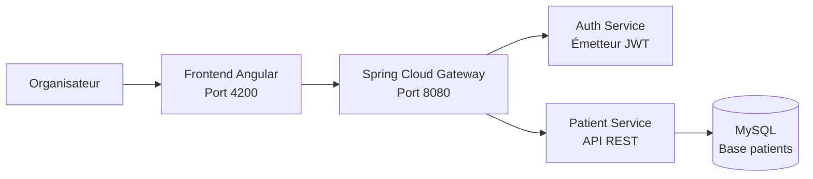

# Medilabo

Medilabo est une application en microservices qui aide les professionnels de santé à gérer les dossiers patients et, à terme, à évaluer le risque de diabète.

Ce dépôt contient les livrables du **Sprint 1**.

## Architecture



| Service | Technologie | Responsabilité |
|---|---|---|
| `frontend-service` | Angular + Nginx | Interface utilisateur |
| `gateway-service` | Spring Cloud Gateway / WebFlux | Point d’entrée unique et validation JWT |
| `auth-service` | Spring Boot / Spring Security | Authentification et création des JWT |
| `patient-service` | Spring Boot / Spring MVC / JPA | Gestion des dossiers patients |
| `mysql` | MySQL 8.4 | Base de données des patients |

## Fonctionnement de la sécurité

1. L’organisateur se connecte depuis l’application Angular.
2. Le frontend envoie les identifiants à `POST /api/auth/login` via la gateway.
3. L’Auth Service authentifie l’organisateur et crée un JWT signé.
4. Le frontend envoie le JWT avec l’en-tête `Authorization: Bearer <token>`.
5. La gateway valide le JWT avant de router la requête.
6. Le Patient Service valide également le JWT avant d’accéder aux données.

L’Auth Service possède la clé privée RSA qui signe les jetons. La gateway et le Patient Service utilisent la clé publique pour vérifier les jetons.

## Fonctionnalités du Sprint 1

- Authentification de l’organisateur avec JWT.
- Gateway sécurisée.
- Consultation de la liste des patients.
- Consultation de la fiche d’un patient.
- Recherche de patients par nom.
- Création d’un patient.
- Modification d’un patient.
- Validation des données obligatoires.
- Base de données MySQL dédiée au Patient Service.
- Insertion automatique des quatre cas de test dans Docker.
- Conteneurisation avec Docker Compose.

## Prérequis

- Docker Desktop
- Java 21
- Node.js et npm
- Git

## Configuration des secrets

Créer un fichier `.env` à partir du modèle :

```bash
cp .env.example .env
```

Compléter le fichier `.env` :

```properties
DB_USERNAME=medilabo_app
DB_PASSWORD=your_database_password
MYSQL_ROOT_PASSWORD=your_mysql_root_password
ORGANIZER_PASSWORD=your_organizer_password
```

Le fichier `.env` est ignoré par Git et ne doit jamais être commit.

## Génération des clés JWT

La clé privée est ignorée par Git. Après avoir cloné le projet, générer une paire de clés RSA :

```bash
mkdir -p auth-service/src/main/resources/keys

openssl genpkey -algorithm RSA \
  -out auth-service/src/main/resources/keys/private.pem \
  -pkeyopt rsa_keygen_bits:2048

openssl rsa -pubout \
  -in auth-service/src/main/resources/keys/private.pem \
  -out /tmp/medilabo-public.pem

cp /tmp/medilabo-public.pem auth-service/src/main/resources/keys/public.pem
cp /tmp/medilabo-public.pem gateway-service/src/main/resources/keys/public.pem
cp /tmp/medilabo-public.pem patient-service/src/main/resources/keys/public.pem
```

## Lancer l’application avec Docker

Depuis la racine du dépôt :

```bash
docker compose up --build
```

Ouvrir ensuite :

- Frontend : http://localhost:4200
- API Gateway : http://localhost:8080

Pour lancer les conteneurs en arrière-plan :

```bash
docker compose up --build -d
```

Vérifier leur statut :

```bash
docker compose ps
```

Arrêter les conteneurs sans supprimer les données MySQL :

```bash
docker compose down
```

## Tests

### Patient Service

```bash
cd patient-service
./mvnw test
```

### Auth Service

```bash
cd auth-service
./mvnw test
```

### Gateway Service

```bash
cd gateway-service
./mvnw test
```

### Frontend Angular

```bash
cd frontend-service
npm ci
npm test -- --watch=false
```

## Endpoints de l’API

Tous les endpoints patient demandent un JWT valide avec le rôle `ORGANIZER`.

| Méthode | Endpoint | Description |
|---|---|---|
| `POST` | `/api/auth/login` | Authentifie l’organisateur et retourne un JWT |
| `GET` | `/api/patients` | Retourne tous les patients |
| `GET` | `/api/patients/{id}` | Retourne un patient par son identifiant |
| `GET` | `/api/patients/search?lastName=value` | Recherche des patients par nom |
| `POST` | `/api/patients` | Crée un patient |
| `PUT` | `/api/patients/{id}` | Met à jour un patient |

